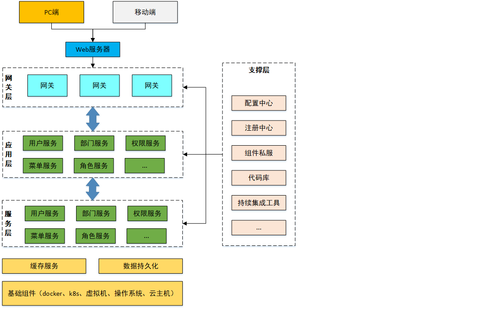
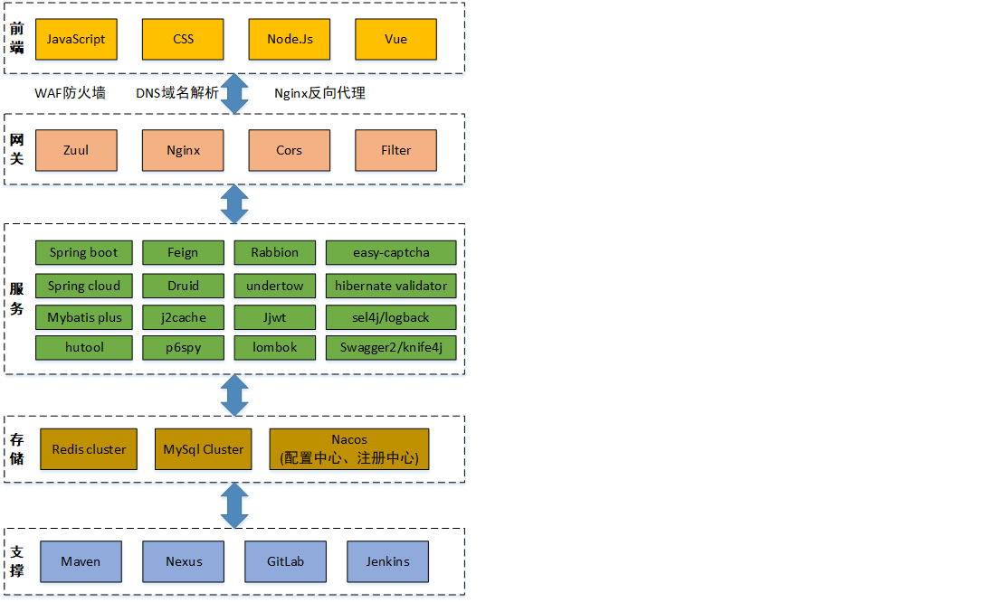

# 品达通用权限系统（pinda-authority）

> ⚠️ 本仓库为个人学习归档，代码著作权归原作者／原课程机构所有。本仓库不授予任何许可，请勿用于商业用途。归属说明见 [NOTICE](NOTICE)。

一套 Spring Cloud 权限脚手架：用户、部门、岗位、角色、菜单管理，网关统一鉴权，JWT 令牌，XSS 防护。同一套底座可以挂多个业务系统并行开发。

关联仓库：品达物流 <https://gitee.com/itxinfei/pinda-tms>

## 一、它解决什么问题

企业项目几乎都要做一遍用户权限、认证鉴权、加解密、XSS 防跨站，思路差不多但每个项目都重写一遍，纯属浪费。这个项目把这部分抽成通用能力：既可以当权限中台，也可以当微服务开发脚手架。

两件事同时成立：

- **权限管理**：用户、部门、岗位、角色、菜单，全部经网关统一鉴权
- **开发框架**：数据库、缓存、日志、表单验证、对象转换、防注入、接口文档等公共组件已封装

## 二、业务架构



## 三、技术架构



## 四、技术栈

| 层 | 选型 |
| --- | --- |
| 框架 | Spring Boot 2.2.2 + Spring Cloud Hoxton.SR1 |
| 网关 | Zuul |
| 注册与配置 | Nacos 1.1.4 |
| 持久层 | MyBatis-Plus |
| 令牌 | JWT（RSA 非对称签名） |
| 缓存 | Redis + J2Cache |
| 接口文档 | Swagger2 + Knife4j |
| 前端 | Vue 2 + vue-cli（`pd-authority-ui`） |

## 五、环境要求

- JDK 1.8+
- Maven 3.3+
- MySQL 5.6+
- Redis 4.0+
- Nacos 1.1.4（单机即可）
- Node 11.3+（自带 npm）

## 六、快速开始

### 1. 起 Nacos 并导入配置

Nacos 是唯一必需的中间件，服务端口、数据源、JWT 密钥路径都在配置中心里。

1. 启动 Nacos 1.1.4，访问 `http://127.0.0.1:8848/nacos`
2. 新建命名空间，记下**命名空间 ID**（不是名称）
3. 导入仓库根目录的 `nacos_config.zip` 中的配置集
4. 改 `pd-parent/pom.xml` 里三个属性，指向你自己的环境：

```xml
<pom.nacos.ip>127.0.0.1</pom.nacos.ip>
<pom.nacos.port>8848</pom.nacos.port>
<pom.nacos.namespace>你的命名空间ID</pom.nacos.namespace>
```

> `nacos_config.zip` 属于本地环境配置，已不纳入版本管理，需自行保留。

### 2. 生成 RSA 密钥对

JWT 用 RSA 非对称签名，私钥签发、公钥验签；网关还要用另一对密钥解密前端的加密密码。密钥不入库，首次拉代码后本地生成一次：

```bash
openssl genrsa -out pri.key 2048
openssl rsa -in pri.key -pubout -out pub.key
```

生成的两个文件分别放到：

| 位置 | 文件 |
| --- | --- |
| `pd-tools/pd-tools-jwt/src/main/resources/` | `pri.key`、`pub.key` |
| `pd-apps/pd-auth/pd-auth-server/src/main/resources/client/` | `pri.key`、`pub.key` |
| `pd-apps/pd-gateway/src/main/resources/client/` | `pub.key` |

漏放会启动报 `pri.key` / `pub.key` 读取失败，或登录时密码解密异常。

### 3. 建库

配置里的库名是 `pd-auth`（带连字符），SQL 是 Navicat 导出的纯表结构，不含建库语句，先建库再导入：

```bash
mysql -u root -p -e "CREATE DATABASE \`pd-auth\` DEFAULT CHARSET utf8mb4"
mysql -u root -p pd-auth < pd_auth.sql
mysql -u root -p pd-auth < pd_goods_info.sql
```

数据源、Redis 地址在 Nacos 的 `mysql.yml`、`redis.yml` 和 `pd-auth-server-dev.yml` 里改，改完重启服务生效。

### 4. 编译与启动

```bash
mvn clean package -DskipTests
```

按顺序起两个服务（配置从 Nacos 拉，先担保配置已导入）：

```bash
java -jar pd-apps/pd-auth/pd-auth-server/target/pd-auth-server.jar
java -jar pd-apps/pd-gateway/target/pd-gateway.jar
```

前端：

```bash
cd pd-authority-ui
npm install
npm run dev
```

## 七、服务与端口

| 应用 | 端口 | 说明 |
| --- | --- | --- |
| pd-gateway | 8760 | 网关，统一入口，上下文路径 `/api` |
| pd-auth-server | 8764 | 权限服务 |
| pd-authority-ui | 8080 | 管理端（vue-cli dev 默认端口） |

## 八、模块结构

```
pinda-authority              # 聚合工程
├── pd-parent                # 父工程：依赖与 Nacos 参数管理
├── pd-apps                  # 应用
│   ├── pd-auth              # 权限服务（entity + server）
│   ├── pd-gateway           # 网关服务
│   └── pd-goods             # 商品服务（示例业务）
├── pd-tools                 # 公共组件
│   ├── pd-tools-common      # 基础配置、统一异常、常量
│   ├── pd-tools-core        # 基础实体、上下文、分布式锁、树
│   ├── pd-tools-databases   # 数据源、数据权限、查询条件
│   ├── pd-tools-dozer       # 对象转换
│   ├── pd-tools-j2cache     # 缓存
│   ├── pd-tools-jwt         # JWT 签发与验签
│   ├── pd-tools-log         # 日志实体、事件、拦截器
│   ├── pd-tools-swagger2    # Knife4j 文档
│   ├── pd-tools-user        # 当前登录用户上下文
│   ├── pd-tools-validator   # 表单校验
│   └── pd-tools-xss         # XSS 防注入
├── pd-authority-ui          # 管理端前端
└── pd-demo                  # 组件示例（j2cache / knife4j / swagger）
```

## 九、演示账号

本地环境初始化后可用的演示账号，仅用于本地联调，不要带到任何公网环境：

- 账号：`pinda`
- 密码：`pinda123`

## 十、许可

本仓库为个人学习归档，**不授予任何许可**，请勿用于商业用途。原始代码著作权归原作者／原课程机构，归属声明见 [NOTICE](NOTICE)。
